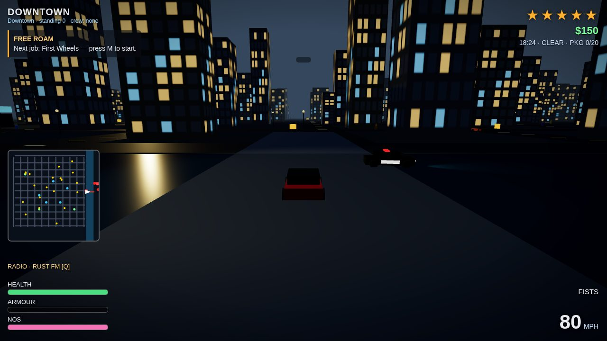

# IRON TIDE — Rustport

[](https://make.fun/bounty/gta6-01?utm_source=github&utm_medium=readme&utm_campaign=gta6-01)
[](https://make.fun/bounty/gta6-01/leaderboard?utm_source=github&utm_medium=readme&utm_campaign=gta6-01)
[](https://make.fun/bounty/gta6-01?utm_source=github&utm_medium=readme&utm_campaign=gta6-01)

**IRON TIDE** is an original open-world crime game set in **Rustport**, a
rainy industrial port city on the River Voss. You are **Mara Voss**, a former
dock worker turned getaway driver who owes the dock union a fortune. Twelve
story jobs stand between her and a clean slate.



## What is in the game

- **Open world** — a 10×10 block city with **14 named districts** (Portside,
  Old Town, Marina, Foundry, Docklands, Downtown, Northgate, Canal Row,
  Market Square, Ironworks, Southbank, Riverside, Harbor View, Airfield),
  a container port with gantry cranes and a moored freighter, a steel
  bridge over the river, and an airfield runway across the water.
- **On foot + driving** — walk, run, punch, shoot, steal any parked car.
  **8 vehicle kinds** (sedan, pickup, sport, truck, taxi, van, muscle,
  police interceptor) with distinct handling, **NOS boost** (Shift) with a
  meter, headlights and damage.
- **Traffic + pedestrians** — cars follow the road grid and turn at
  intersections; pedestrians stroll the sidewalks and panic when shots
  ring out or a car screams past.
- **Wanted system, 5 stars** — crimes raise the heat; patrol cars chase
  and ram; **roadblocks** at 3+ stars; a **police helicopter** with a
  searchlight at 3+ stars; **line-of-sight** heat decay — break sight,
  swap cars, repaint, or hide in a safehouse to cool off.
- **12 story missions** — First Wheels, The Crate Run, Shake the Tail,
  Night Cab, Pawn Shop Hold, River Run, Marina Vault, The Crew, Dockside
  Chase, Interceptor, The Big Score, Clean Slate. Briefings, dialogue,
  gold beacons, cash rewards and district standing.
- **Crew** — recruit **Jax** and **Lena**; they ride with you on the heist.
- **3 street races** — River Run, Bridge Sprint, Port Loop, with
  checkpoints, timers and saved best times.
- **Side activities** — taxi fares, vigilante takedowns, **20 hidden
  packages**, stunt jumps with slow motion and cash bonuses.
- **Day/night cycle + weather** — a full day in four minutes, lamps and
  lit windows at night, rain that makes the streets shine.
- **Combat** — fists, pistol, SMG and shotgun, bought at the gun shop
  with ammo; armed enemies in missions.
- **Garage + upgrades** — engine, armour and NOS upgrades per car.
- **Shops + safehouses** — gun shop, clinic, paint shop, garage, diner,
  and three safehouses (apartment, motel, boathouse) that heal and clear
  the wanted level.
- **District standing** — reputation per district, earned from jobs, that
  discounts shop prices.
- **HUD** — wanted stars, cash, health, armour, speed, NOS meter, weapon
  + ammo, live minimap (roads, river, player, beacon, police, roadblocks,
  shops, packages), mission objective, dialogue subtitles, city clock,
  radio and district name.
- **Radio** — four procedural WebAudio stations (RUST FM rock, NEON 88
  synthwave, PORT TALK, TIDE JAZZ), switch with Q.
- **Save / load** — mission progress, cash, gear, upgrades, collectibles,
  best race times and crew persist in localStorage; Continue on the
  start screen.

## Controls

| Key | Action |
| --- | --- |
| WASD | drive / walk |
| Shift | NOS boost (in car) / run (on foot) |
| E | enter or steal a car / use a shop / safehouse |
| F | punch |
| G | shoot |
| 1–4 | switch weapon |
| Q | next radio station |
| M | start the next story mission |
| R | start the nearest street race |
| Space | brake |
| H | horn |
| P / Esc | pause |

## Play it

```bash
node serve.ts
# open http://localhost:8080
```

No build step, no network requests: everything is static files under
`game/`, and three.js r160 is vendored at `game/vendor/three.module.min.js`.

## Screenshots

All four screenshots are real renders of the game itself, taken in a
headless browser (`?shot=chase|street|mission|start`):

1. `1-chase.jpg` — five-star chase on the steel bridge at dusk
2. `2-street.jpg` — on foot in Old Town at night
3. `3-mission.jpg` — The Big Score in progress
4. `4-start.jpg` — aerial view of Rustport at golden hour

## Originality

IRON TIDE is an original game: its own city, characters, vehicles, names,
story, art, sounds and music. Nothing from Rockstar Games' Grand Theft
Auto series or any other commercial game. Three.js is MIT-licensed (see
`game/vendor/THREE-LICENSE.txt`).

## License

MIT — see [LICENSE](LICENSE).
